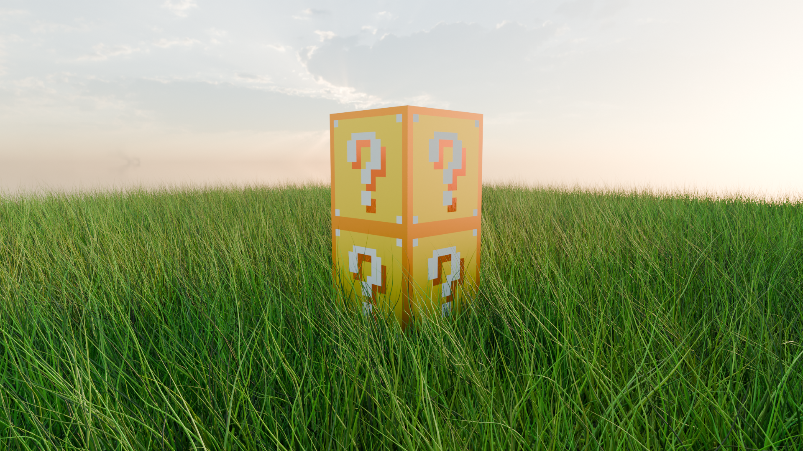

# Minecraft Lucky Blocks Blender 3D Scene

A stylized 3D scene featuring two Minecraft-inspired Lucky Blocks in a field of tall grass, illuminated by a warm sunset.

This is a personal learning project created as I develop my skills in 3D modeling, materials, lighting, and environment creation using Blender.

## Final Render

## Project Overview

**Software:** Blender  
**Project type:** 3D modeling and environment art  
**Style:** Stylized, game-inspired 3D scene

### My Contributions

- **Prop modeling:** Modeled two Minecraft-inspired Lucky Blocks, including their geometric forms, question-mark symbols, and decorative details.
- **Environment modeling:** Created the grass environment by following a modeling tutorial.
- **Materials:** Worked with colors and materials to achieve the recognizable Lucky Block appearance.
- **Lighting and composition:** Arranged the scene around a sunset atmosphere, using the blocks as the main focal point.
- **Rendering:** Combined the modeled assets and environment into a final rendered image.

### Tools and Resources

- **Blender** — 3D modeling, scene setup, materials, and rendering.
- **Poly Haven** — Source of the downloaded sky/environment texture.

### What I Learned

This project helped me explore the process of creating 3D props and placing them within a larger environment. I gained practice with modeling, material setup, lighting, and composition, while learning how to bring separate scene elements together into a final render.

### Future Improvements

- Create additional camera angles and close-up renders.
- Improve the grass distribution and environmental details.
- Experiment with lighting, shadows, and materials.
- Develop more original game props and environments.

---

*Personal project created as part of my journey toward becoming a 3D artist specializing in props, environments, and eventually characters.*
